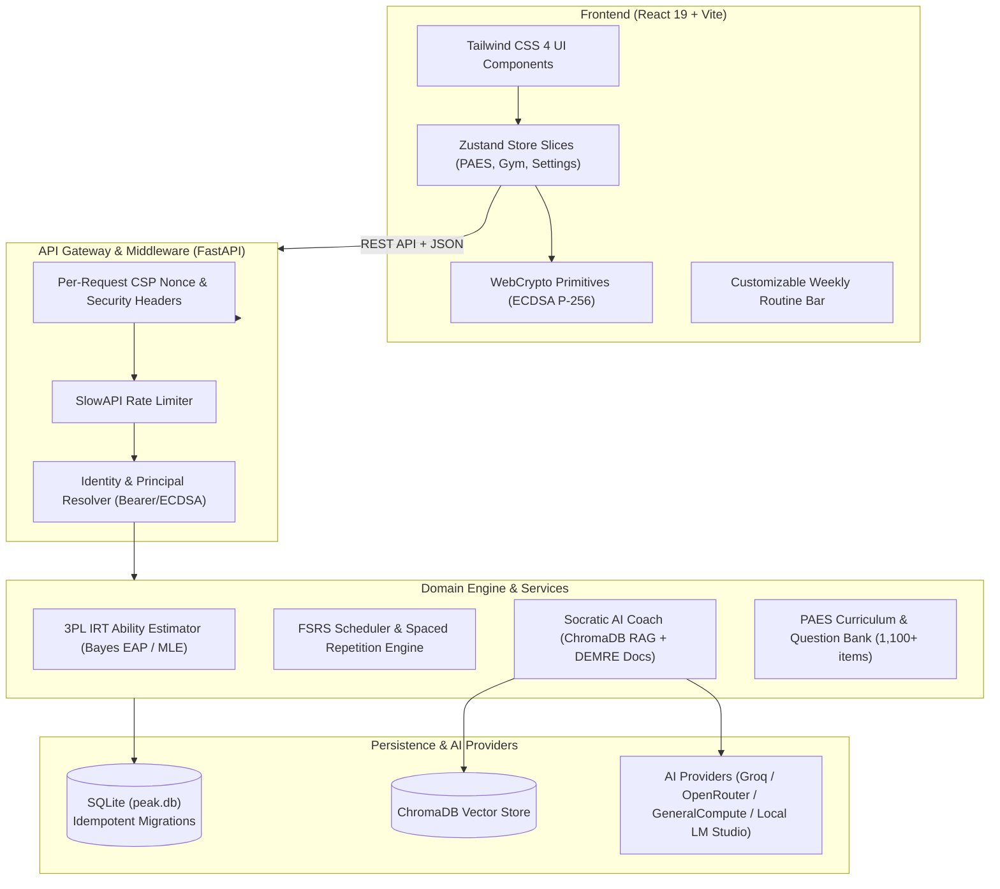

<div align="center">

# New Peak

**High-Performance PAES Preparation Platform**  
*3PL Item Response Theory Calibration · FSRS Spaced Repetition · Hardened Deliberate Practice*

[](https://github.com/Hunther4/New-Peak/actions/workflows/ci.yml)


</div>

> **Project status:** The single-tenant hardened edition is the deployed baseline today. The multi-user foundation program (identity → per-user ownership → encrypted credentials) is under active development — see the roadmap below.

---

## Overview

**New Peak** is a modern, self-hostable preparation and psychometric tracking system engineered specifically for the **PAES** (Prueba de Acceso a la Educación Superior, Chile's university admission exam). 

Built to replace legacy study software, New Peak bridges the gap between raw question drills and cognitive mastery through:
1. **Psychometric Precision:** Official DEMRE curve scaling and 3-Parameter Logistic (3PL) Item Response Theory ($\theta$ latent ability estimation via Bayes EAP and Newton-Raphson MLE).
2. **Memory Retention:** FSRS (Free Spaced Repetition Scheduler) with adaptive Leitner progression isolated per subtopic.
3. **Targeted Review:** *Cuaderno Negro de Errores* (Error Vault) with zero-forgiveness revenge study modes.
4. **Spec-Driven Hardening:** Nonced CSP security, hardened upload perimeter, ECDSA identity primitives, and a slice-verified multi-user foundation in active development.

---

## System Architecture



---

## Key Features

* **3PL Item Response Theory (IRT):** Calculates student ability ($\theta$) across discrimination ($a$), difficulty ($b$), and guessing ($c$) parameters calibrated from official DEMRE scaling tables.
* **FSRS Spaced Repetition:** Calculates retrievability and optimal review intervals per subject subtopic (`Matemática M1/M2`, `Lectura`, `Ciencias`).
* **Weekly Study Routine Planner:** 1-Click scheduling toolbar with persistent custom presets (e.g., *Enfoque M1 UBB*, *Full Matemáticas*), collapsible compact views, and automated day tracking.
* **Error Vault & Revenge Mode:** Dedicated catalog of missed questions tagged by misconception type with step-by-step distractor resolutions.
* **Cognitive Gym:** Integrated mental math, Dual N-Back working memory training, and cognitive bridges for academic endurance.
* **Hardened Perimeter:** Dynamic Content Security Policy (CSP) nonces per request, strict MIME-type sniffing prevention for uploads, bcrypt 72-byte password guards, and ECDSA signature verifications.

---

## Quickstart

### Prerequisites
* **Windows** with PowerShell 5.1+
* **Python 3.11+** (virtual environment inside `backend/venv`)
* **Node.js 22+** and [pnpm](https://pnpm.io/)

### 1-Click Launch
Start both the FastAPI backend and Vite frontend concurrently using the automated PowerShell launcher:

```powershell
.\paes.ps1
```

The launcher automatically:
1. Validates virtual environments and dependencies.
2. Checks port availability (`8000` and `7700`) to prevent port conflicts or zombie processes.
3. Boots FastAPI (`--reload`) and Vite (`--strictPort`).
4. Polls HTTP endpoints until live readiness is confirmed, then launches your default browser.

**Default URLs:**
* Frontend Web App: [http://localhost:7700](http://localhost:7700)
* Backend OpenAPI Docs: [http://127.0.0.1:8000/docs](http://127.0.0.1:8000/docs)

---

## Configuration

Environment variables are loaded from `backend/.env`. A documented template is available at [`backend/.env.example`](backend/.env.example).

| Variable | Description | Default |
| :--- | :--- | :--- |
| `DATABASE_URL` | SQLite connection string | `sqlite:///./peak.db` |
| `GROQ_API_KEY` | Optional Groq key for fast inference (Socratic Coach) | `""` |
| `OPENROUTER_API_KEY` | Optional OpenRouter key for Socratic Coach routing | `""` |
| `GENERALCOMPUTE_API_KEY` | Optional GeneralCompute key as a third cloud provider | `""` |
| `LM_STUDIO_BASE_URL` | Local LLM inference server endpoint (OpenAI-compatible) | `http://127.0.0.1:1234/v1` |
| `ENROLLMENT_TOKEN` | Secret token required to register new devices (planned — ships with slice S2) | `""` |
| `DISABLE_AUTH` | Local dev auth bypass (strictly rejected when `PRODUCTION=1`) | `0` |

---

## Quality Gates & Testing

Quality standards are strictly enforced locally and on GitHub Actions CI.

### Backend (Pytest + Ruff)
Executed with the virtual environment interpreter from `backend/`:

```bash
# Backend suite: 800+ tests, enforced 72% coverage threshold (the frontend suite adds 200+)
python -m pytest --cov=api --cov=core --cov=models --cov=services --cov-report=term-missing

# Lint with zero-tolerance ruff rule checks
ruff check .
```

* Coverage is enforced via `backend/pyproject.toml` (`fail_under = 72`); the current backend coverage is ~81%.
* Zero lint warnings tolerated under `ruff==0.8.6`.

### Frontend (Vitest + Vite)
Executed from `frontend/`:

```bash
# Run unit & component tests with coverage
pnpm run test:coverage

# Verify production bundle build
pnpm run build
```

* Test environment: `jsdom` with `@testing-library/react`.
* Enforced coverage thresholds in `frontend/vite.config.js`: Statements $\ge 38\%$, Branches $\ge 28\%$, Functions $\ge 32\%$, Lines $\ge 39\%$.

---

## Multi-User Roadmap (OpenSpec)

The system is transitioning from a single-tenant deployment to a cryptographically verified multi-tenant architecture tracked under [`openspec/changes/multi-user-foundation`](openspec/changes/multi-user-foundation/proposal.md).

**Snapshot as of 2026-10-22.** The authoritative slice-level status lives in [`openspec/changes/multi-user-foundation/tasks.md`](openspec/changes/multi-user-foundation/tasks.md).

| Slice | Milestone | Focus Area | Status |
| :---: | :--- | :--- | :---: |
| **S1** | **Identity Schema & Cryptography** | `users`, `user_devices`, `auth_sessions` tables + ECDSA P-256 primitives |  |
| **S2** | **Enrollment & Legacy Bootstrap** | One-shot migration of single-user data & public key device registration |  |
| **S3** | **Challenge & Session Lifecycle** | Cryptographic challenge/verify rounds, bearer tokens, sliding expiry |  |
| **S4** | **PAES Principal Scoping** | Removal of client-supplied `user_id` in favor of authenticated principal |  |
| **S5** | **Browser Key Management** | WebCrypto device keys in client IndexedDB; eliminate API keys from bundle |  |
| **S6** | **Auth Gate & Login Surface** | Client authentication gate preventing unauthenticated dashboard leaks |  |
| **S7** | **Ownership Migration 014** | Foreign key enforcement on all practice tables with dump verification gate |  |
| **S8** | **Peak Practice Isolation** | Gym and cognitive exercise session isolation per principal |  |
| **S9** | **Encrypted Provider Keys** | Per-user AES-256-GCM + HKDF sealed API keys for LLM providers |  |
| **S10** | **Per-Principal Router** | Dynamic credential injection into AI coach without global key caches |  |
| **S11** | **Strict Boundary Enforcement** | Full test suite execution with live identity boundaries active |  |

---

## Project Structure

```text
├── backend/
│   ├── api/            # Route handlers (auth, paes, coach, models, gym)
│   ├── core/           # Security, ECDSA crypto, database sessions, middleware
│   ├── models/         # SQLModel database schemas (identity, paes, exercises)
│   ├── services/       # Domain business logic (3PL IRT, FSRS, psychometrics)
│   ├── migrations/     # Versioned, idempotent schema migration scripts
│   └── tests/          # Pytest backend test suite (800+ tests)
├── frontend/
│   ├── src/
│   │   ├── api/        # HTTP client & backend proxy bindings
│   │   ├── components/ # Atomic UI components, PAES routine bar, exams
│   │   ├── pages/      # Route pages (PaesStudy, Gym, Settings, Dashboard)
│   │   └── store/      # Modular Zustand state management slices
│   └── vite.config.js  # Build tooling, proxies, and coverage thresholds
├── openspec/           # Spec-driven development change proposals & tasks
├── .github/workflows/  # CI pipelines with dependency caching (pip & pnpm)
├── paes.ps1            # Resilient Windows service orchestrator
└── README.md           # Repository documentation
```

---

## Contributing

Issues and pull requests are welcome. Keep changes review-scoped: branch from `main`, run the quality gates (`ruff check .`, backend pytest, `pnpm run test:coverage`), and organize larger work as scoped slices under the [OpenSpec plan](openspec/changes/multi-user-foundation/tasks.md).

## Support

Open a GitHub issue on this repository with a descriptive title and the failing command, plus the relevant log from `logs/backend.log` or `logs/frontend.log`.

---

## License

This project is licensed under the terms of the [GNU General Public License v3.0](LICENSE).
